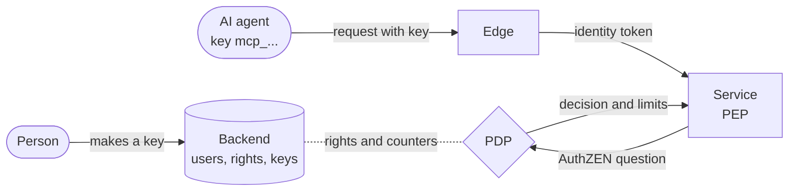
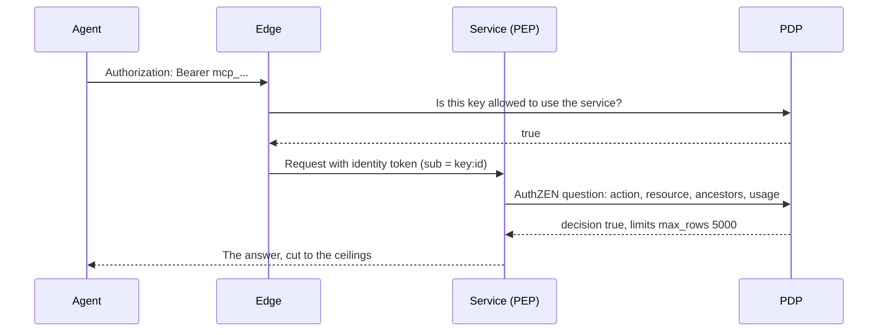
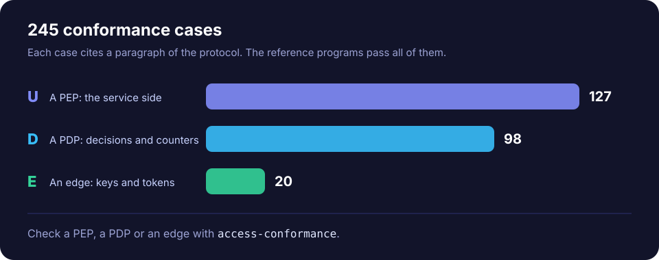
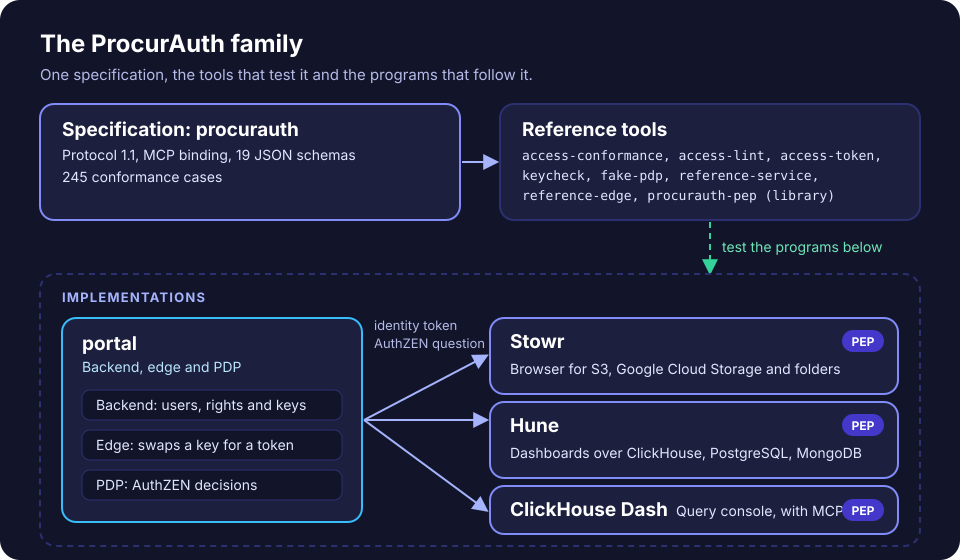

<p align="center">
  
</p>

<p align="center">
  <a href="https://github.com/ProcurAuth/procurauth/actions/workflows/ci.yml"></a>
  <a href="https://github.com/ProcurAuth/procurauth/releases/latest"></a>
  
  
  
  
  
</p>

<p align="center">
  <a href="https://procurauth.github.io/procurauth/"><b>Website</b></a> ·
  <a href="https://procurauth.github.io/procurauth/specification.html">Protocol</a> ·
  <a href="https://procurauth.github.io/procurauth/mcp-binding.html">MCP binding</a> ·
  <a href="https://procurauth.github.io/procurauth/tools.html">Tools</a> ·
  <a href="https://procurauth.github.io/procurauth/implementations.html">Implementations</a> ·
  <a href="SECURITY.md">Security</a> ·
  <a href="https://github.com/ProcurAuth/procurauth/releases/latest">Downloads</a>
</p>

# ProcurAuth

ProcurAuth is an open specification for services that let AI agents act for people.

A backend holds the users, their rights and the keys of their agents. A person makes a key for an agent. **A key never has more rights than the person who owns it.** A service does not know the backend. It speaks only [AuthZEN](https://openid.net/specs/authorization-api-1_0.html).

It is for the teams that build a service that agents call, and for the teams that build the backend that decides. This repository holds the protocol, the MCP binding, the JSON schemas, 245 conformance cases and the programs to test a service.

<p align="center">
  
</p>

## How it works

An agent calls a service with its key. The edge swaps the key for a short identity token. The service asks the decision point (PDP) with one AuthZEN question. The PDP answers with the decision and the limits that apply.





| Part | What it gives |
| --- | --- |
| **Keys** | A key has the subject `key:<id>`. A key has its own grants, and never more than its owner. |
| **Resource chains** | A service sends `resource.properties.ancestors`. A grant on a node covers all its children. |
| **Limits** | A ceiling is a value that the service applies, such as `max_rows`. A budget is a count that the PDP keeps, such as requests for each minute. |
| **Identity token** | A short JWT (`Ed25519` or `ES256`) that the edge signs. The service reads `sub` and sends it to the PDP. |
| **Refusals** | A PDP answers `false`, with the reason `budget_exceeded` and `retry_after` when a budget is spent. |
| **Approvals** | The PDP can ask for the approval of the owner of a key for a use of any action. Section 17 is mandatory for a service. The PEP learns only the verdict. |
| **MCP binding** | The rules for a service with an MCP endpoint: tools, approvals and JSON-RPC errors. |

## Example

Alice has the grant `data.read` on the database `test2`, with `max_rows` 5000. She also has a grant on the table `orders`, with `max_rows` 100. The service asks one question:

```json
{ "subject":  { "type": "user", "id": "alice" },
  "action":   { "name": "data.read" },
  "resource": { "type": "table", "id": "orders",
                "properties": { "ancestors": [ { "type": "service", "id": "datastore" },
                                               { "type": "host", "id": "prod" },
                                               { "type": "database", "id": "test2" } ] } },
  "context":  { "usage": { "units": 1 } } }
```

The PDP answers with the lowest value of each ceiling:

```json
{ "decision": true, "context": { "limits": { "max_rows": 100, "max_duration": 30 }, "usage": { "units": 1 } } }
```

When the budget is spent, the answer is:

```json
{ "decision": false, "context": { "reason": "budget_exceeded", "retry_after": 12 } }
```

Section 13 of the protocol has the full example, with the key of an agent.

## Tools

Seven programs help you to build and to test a service. They are Rust programs. The Linux builds are static files with no dependency.

| Program | What it does |
| --- | --- |
| `keycheck` | Checks the text of a key against a key format. |
| `access-token` | Makes and checks identity tokens. It runs the checks of protocol 9.4 and prints the result of each one. |
| `access-lint` | Checks the action document of a service, a file of grants and an answer of the options route. |
| `fake-pdp` | A test PDP that serves AuthZEN 1.0 from fixed data. Use it to run a service with no backend. |
| `access-conformance` | Runs the conformance cases against a PEP, a PDP or an edge. |
| `reference-service` | A small service that uses the library `procurauth-pep`. It passes the series U. |
| `reference-edge` | A small edge: a reverse proxy that swaps a key for a token. It passes the series E. |

The library `procurauth-pep` in `crates/procurauth-pep` has the checks that a PEP must do. Its optional feature `tls` gives a link to the PDP over TLS.

## Quick start

This start takes five minutes on Linux x86-64. Each [release](https://github.com/ProcurAuth/procurauth/releases/latest) also has archives for Linux aarch64, macOS (Apple silicon and Intel) and Windows (x86-64). Docker is not necessary.

```sh
curl -LO https://github.com/ProcurAuth/procurauth/releases/download/v1.1/procurauth-tools-1.1-x86_64-linux.tar.gz
curl -LO https://github.com/ProcurAuth/procurauth/releases/download/v1.1/SHA256SUMS
sha256sum -c SHA256SUMS --ignore-missing
tar xzf procurauth-tools-1.1-x86_64-linux.tar.gz
git clone --depth 1 --branch v1.1 https://github.com/ProcurAuth/procurauth
cd procurauth
export PATH="$PWD/../procurauth-tools-1.1-x86_64-linux:$PATH"
```

Make an identity token with the test key, and check it. The tool prints one line for each check. This is a short extract.

```sh
access-token make --key crates/access-token/examples/test-edge-ed25519.pem --alg Ed25519 \
    crates/access-token/examples/claims.json > token.jwt
access-token check --config crates/access-token/examples/service.json --now 1792569700 token.jwt
```

```text
structure  ok   3 parts
alg        ok   Ed25519
typ        ok   JWT
signature  ok   good
claims     ok   iss, sub, aud, iat, exp
life       ok   life 300 s, max 300 s
```

Run the 98 conformance cases of the series D against the test PDP. The last line is `98 cases: 97 passed, 0 failed, 1 skipped`.

```sh
access-conformance --role pdp --profile crates/access-conformance/examples/pdp-fake.json
```

## Conformance

<p align="center">
  
</p>

The cases are data, in `conformance/`. Each case cites a paragraph of the protocol. `conformance/COVERAGE.md` shows which paragraph has a case. To test your own service, write a profile and run the cases:

```sh
access-conformance --role pep  --profile my-service.json --url http://127.0.0.1:8000
access-conformance --role pdp  --profile my-pdp.json     --url http://127.0.0.1:8001
access-conformance --role edge --profile my-edge.json    --url http://127.0.0.1:8002
```

The runner prints one line for each case and a summary line, for example `127 cases: 126 passed, 0 failed, 1 skipped`. Section 17 of the protocol is mandatory for a service, so the runner never skips its cases for a PEP.

The runner skips a case that needs a feature that the target does not have. A PDP that gives no approval skips D76 to D89, D91 to D93 and D95 to D97. An edge that does not know the key with `confirm` skips E19. A profile with no credential of the service skips D97. In this version, `fake-pdp` and `reference-edge` give these features.

## The ProcurAuth family

This repository is the specification. The organisation [ProcurAuth](https://github.com/ProcurAuth) also holds programs that follow it. The [implementations page](https://procurauth.github.io/procurauth/implementations.html) and [IMPLEMENTATIONS.md](IMPLEMENTATIONS.md) list them, with the results of the conformance runs and the pinned commits. To add your program, open an issue.

<p align="center">
  
</p>

## Documentation

| Document | Content |
| --- | --- |
| [Protocol](protocol/procurauth-protocol.md) and [MCP binding](bindings/mcp/procurauth-mcp-binding.md) | The normative texts. The [site](https://procurauth.github.io/procurauth/) shows them as HTML. |
| [JSON schemas](schemas/) | One schema for each document and each file of the tools, 19 in all. The site serves each at the address in its `$id`. |
| [Conformance](conformance/README.md) | The data model of a case, the profile, and the [coverage table](conformance/COVERAGE.md). |
| [Tools](https://procurauth.github.io/procurauth/tools.html) | The page of each program. Each crate in `crates/` also has a README. |
| [Implementations](IMPLEMENTATIONS.md) | The known implementations, with their results. |
| [Changelog](docs/CHANGELOG.md) | The changes of each version. |
| [Design records](docs/design/README.md) and [architecture](devdocs/architecture.md) | The decisions and the structure of the code, for a developer. |

## Repository

| Path | Content |
| --- | --- |
| `protocol/`, `bindings/mcp/` | The protocol and the binding, in Markdown. They are neutral and do not name a product. |
| `schemas/`, `conformance/` | The JSON schemas, and the cases with the coverage table. |
| `crates/` | The Rust programs and the library. |
| `docs/` | The source of the [website](https://procurauth.github.io/procurauth/). GitHub Pages serves this directory. |
| `scripts/` | The scripts that run the checks in Docker, and `check-docs.py`. |

### Build and test

Use Docker. Do not install Rust on your machine.

```sh
scripts/ci.sh                    # format, lint, tests and the conformance runs
scripts/cargo.sh build --release
scripts/static.sh --check        # static Linux programs (musl)
python3 -I scripts/check-docs.py # links, site, ASD-STE100 and hygiene of the files
```

## Security

Report a vulnerability with the private reports of GitHub. Do not open a public issue. [SECURITY.md](SECURITY.md) gives the scope and the response times. The repository holds public test keys that protect nothing.

## Contribute

Open an issue to ask a question or to report an error in the texts. Cite the number of the paragraph. [CONTRIBUTING.md](CONTRIBUTING.md) tells how to change a text, a case or the code. This project follows the [code of conduct](CODE_OF_CONDUCT.md).

## Licence

- The texts are under CC BY 4.0. See `LICENSE-TEXTS.txt`.
- The code is under Apache-2.0. See `LICENSE`.
